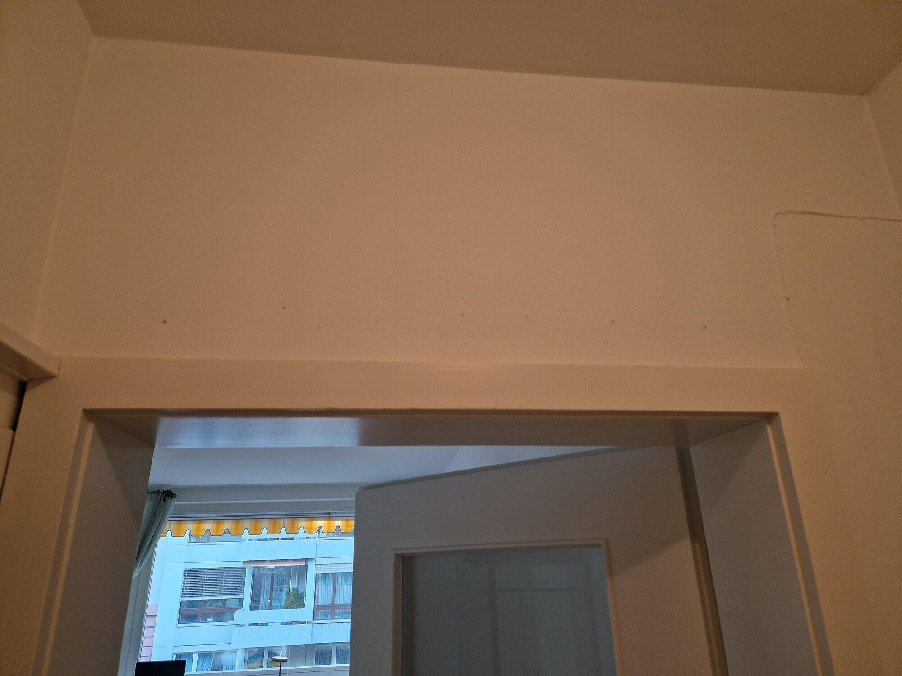
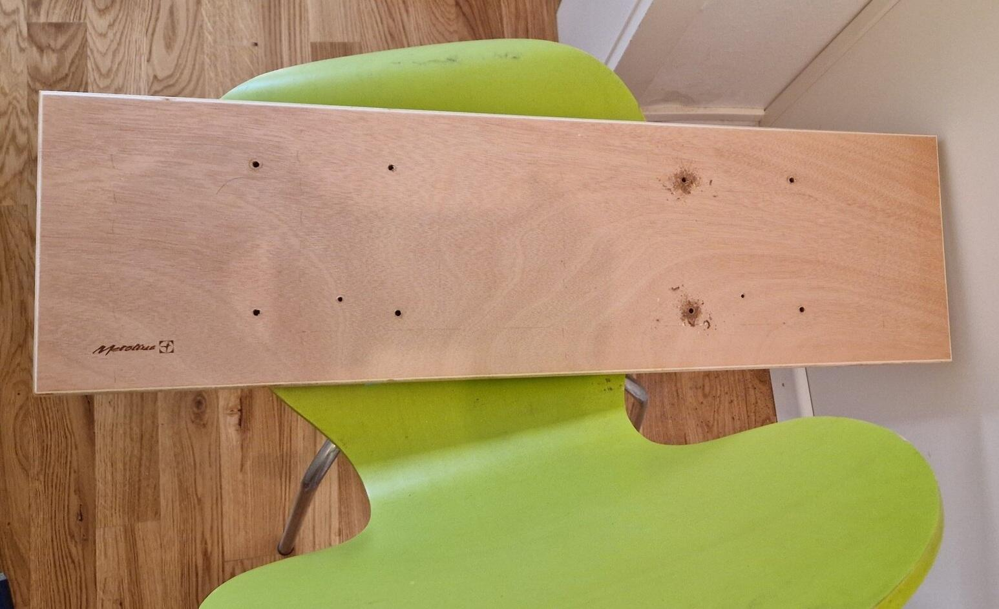
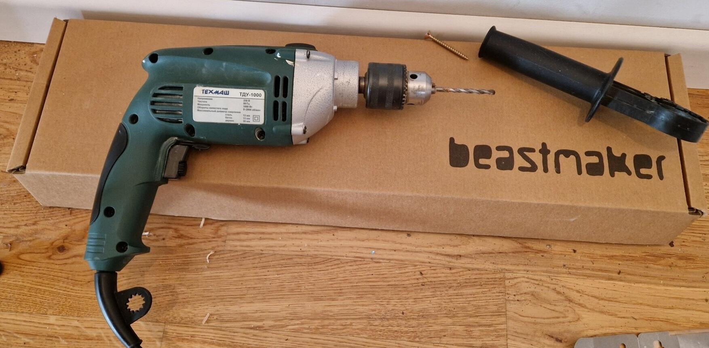
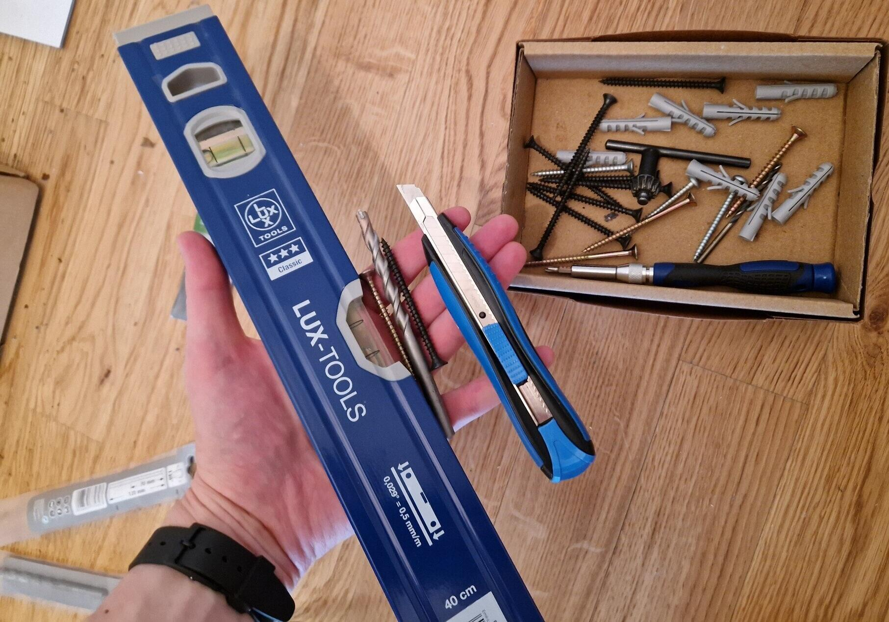
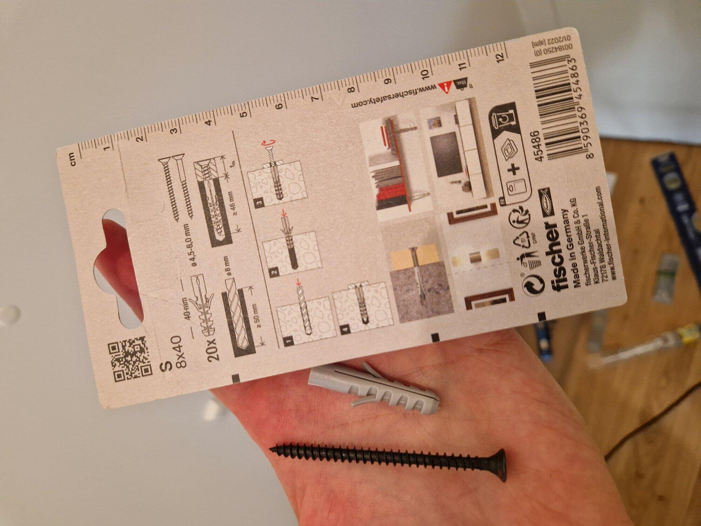
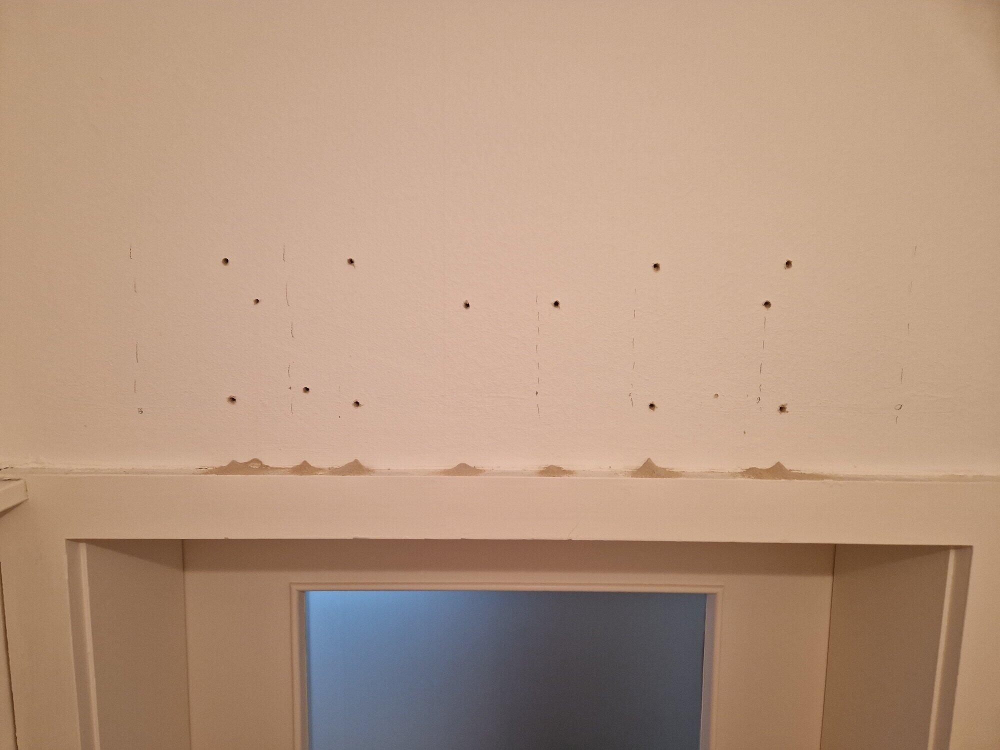
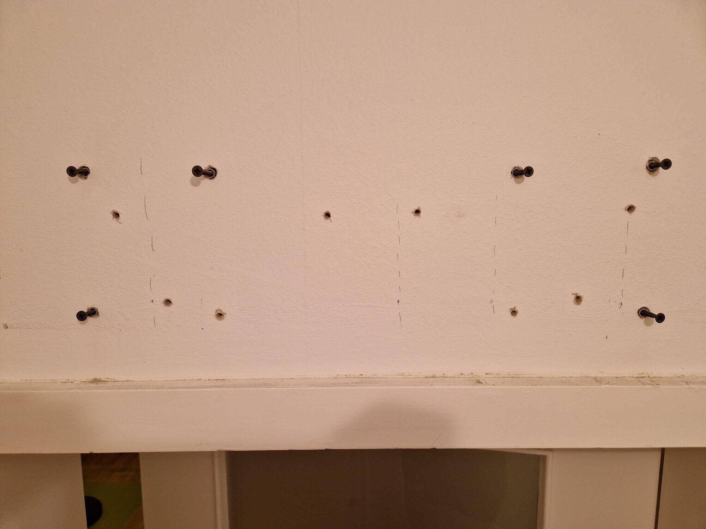
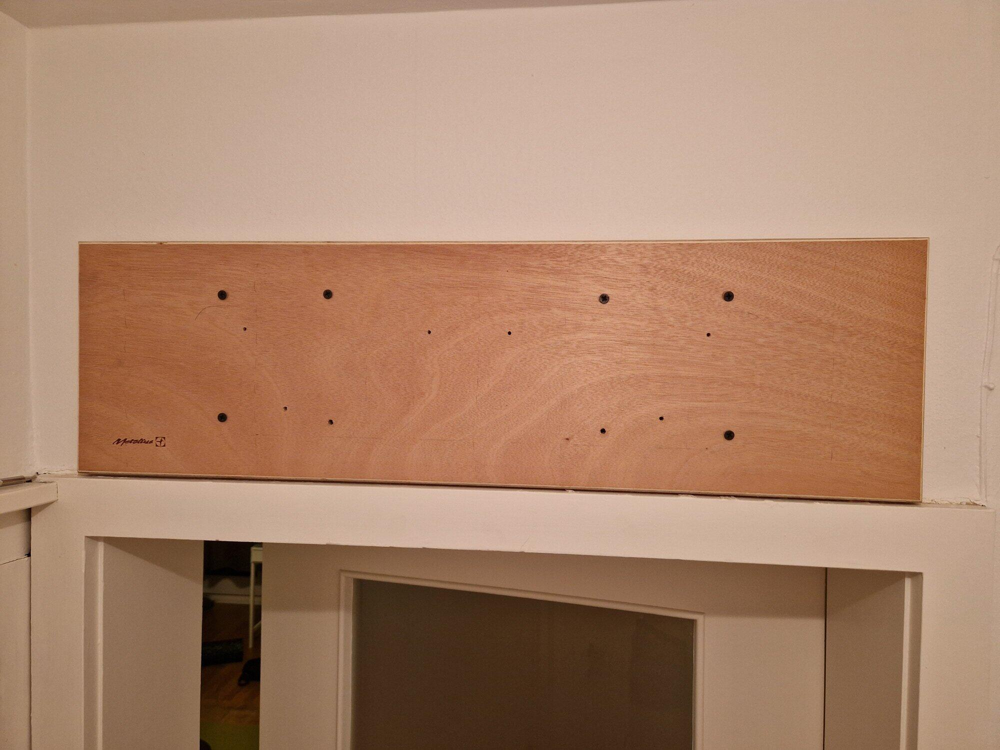
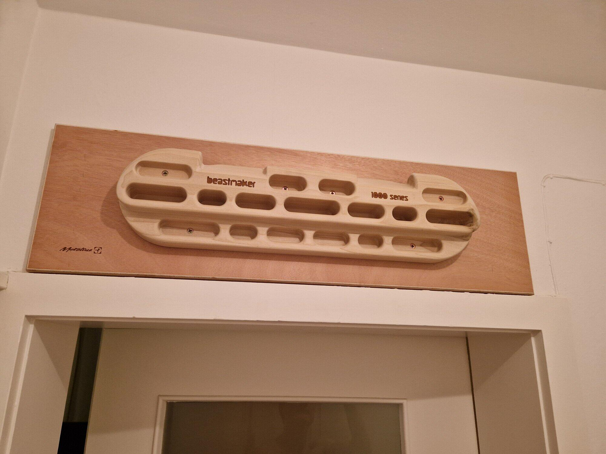

Every climber reaches a point in their journey where they look at the empty space above their bedroom door and think: *“I could put a hangboard there.”*

This is the story of how that thought became a reality, turning a blank wall into a finger-strength training station. Here is the step-by-step saga of mounting a **Beastmaker 1000 Series** hangboard above a concrete door frame.

---

### Step 1: The Blank Canvas

It all starts with a dream and a blank wall. The space above a doorway is ideal because it allows your legs and body to hang freely, but it is also a high-stress area. You cannot simply screw a hangboard directly into the plaster; you need a solid plan to anchor it safely.

---

### Step 2: The Foundation (Metolius Backing Board)

To avoid tearing down the wall and to distribute the forces evenly, we use a wooden backing board (in this case, a Metolius mounting board). This board is anchored securely into the solid wall structure, providing a stable, flat surface to screw the Beastmaker into. 

---

### Step 3: Unboxing the Beast & Preparing the Power

With the backing board ready, it was time to open the main event: the **Beastmaker 1000**. Alongside the beautiful wooden board, I dug out my trusty **Texmash TDU-1000** impact drill. A solid drill is non-negotiable when dealing with concrete or brick walls.

---

### Step 4: Organizing the Arsenal

DIY projects live and die by preparation. I gathered the essential tools for the job:
*   A **LUX-TOOLS 40 cm spirit level** (crucial—nobody wants to train on a slanted board).
*   A utility knife for opening packages and clean cuts.
*   A masonry drill bit matching the anchor size.
*   A screwdriver and selection of screws.

---

### Step 5: Choosing the Right Anchors

When hanging your body weight (plus dynamic force) off a wall, cheap drywall screws won't cut it. I opted for **Fischer S 8x40** wall plugs (8mm diameter, 40mm depth) and matching heavy-duty black wood screws. 

> [!TIP]
> Always check the packaging recommendations. For the Fischer S 8x40, a hole depth of at least 50mm and an 8mm drill bit are required for maximum load capacity.

---

### Step 6: Making the Holes

With the backing board held up and leveled, I marked the drilling points. Then came the noisy, messy part: drilling the 12 anchor holes. You can see the neat little piles of concrete dust resting on top of the door frame, a testament to the Texmash's impact mode.

---

### Step 7: Inserting Anchors & Preparing Screws

Next, the Fischer wall plugs were tapped into the holes, and the long black screws were started. Having the screws partially inserted in the wall beforehand makes aligning and mounting the heavy wooden backing board much easier.

---

### Step 8: Securing the Backing Board

The backing board is up! It went on smoothly and was screwed tight until it was completely flush with the wall. A quick check with the spirit level confirmed everything was perfectly horizontal.

---

### Step 9: Unleashing the Beastmaker

Finally, the moment of truth. The Beastmaker 1000 was aligned on the backing board and screwed in using the wood screws provided. The wood-on-wood mount is incredibly strong and looks fantastic. 

With the board solid as a rock, it was time to chalk up and test the 35-degree slopers. Let the training sessions begin!
