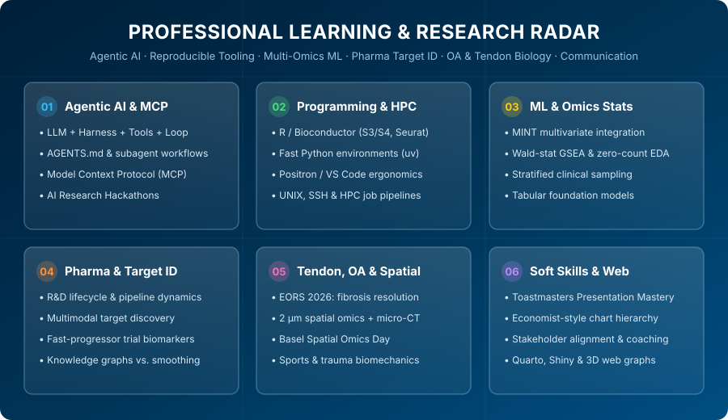

{fig-alt="Professional Learning & Research Radar" width="100%"}

In computational biology and translational data science, the ground shifts underneath your feet almost every quarter. Between new spatial multi-omics technologies, modern package managers, the realities of pharmaceutical R&D pipelines, and the rapid evolution of agentic AI workflows, a big part of my weekly routine is dedicated to structured learning and note-taking.

Recently, I looked back through my personal Notion `LEARN` and conference hubs to take stock of what I have been studying, testing, and refining professionally. Here is a synthesis of the six major tracks on my desk right now—plus the community events I am most excited to attend next and why I am deeply motivated to bring my ongoing research on **tendinopathy and osteoarthritis (OA)** across the finish line.

---

## 1. Agentic AI, Guardrails, and the Model Context Protocol (MCP)

We have moved rapidly past the era of simply copy-pasting snippets into a chatbot. My recent focus has been understanding how **AI coding agents** actually operate under the hood—and how to use them in scientific computing without sacrificing rigor or reproducibility.

> *"You can use AI only to the extent where you can verify it."* — **Terence Tao**

### The Mental Model: Agent = LLM + Harness + Tools + Loop
An AI agent isn't magic; it is a language model placed inside a **harness**—a surrounding program that exposes **read tools** (listing files, reading code, querying databases) and **write tools** (editing files, running tests, executing shell commands) in an iterative **observe $\rightarrow$ act $\rightarrow$ verify** loop.

### Beyond "Vibe Coding" to Disciplined AI-Assisted Development
In my notes, I draw a sharp line between *vibe coding* (prompting until something appears to work—fine for single-use prototypes) and **disciplined agentic engineering**:

* **`AGENTS.md` & Custom Skills**: Maintaining explicit repository rules (`AGENTS.md`, `R-coder.md`) so coding agents immediately follow project conventions: keeping scripts modular (`01_load_data`, `02_qc_filter`), separating `/input/rawdata` from `/output/script_name/`, and avoiding bloated defensive boilerplate on the first iteration.
* **Subagent Delegation**: Using specialized subagents for isolated tasks (e.g., literature search, codebase exploration, or code review) to keep the primary reasoning context clean.
* **Model Context Protocol (MCP)**: Treating MCP as the universal connector (`Host → Client → Server`) that bridges LLMs with local tools, biomedical databases, and knowledge bases like Notion—while enforcing strict least-privilege and keeping API tokens out of git history and chat logs.

::: {.callout-warning}
### Hard-Won Lesson: Why Backups & Sandboxes Are Non-Negotiable
Giving an agent shell and filesystem write access carries real risk. In one memorable session, an agent was asked to back up a branch worktree before a history rewrite; due to a working-directory slip (`cd` failing silently), its cleanup step deleted the active branch directory instead of the duplicate! Daily filesystem snapshots saved the day—reinforcing why **sandboxing**, **small reviewable diffs**, and **automated snapshots** are mandatory when working with autonomous agents.
:::

### Scientific Literature & The Verification Burden
Following recent analyses in *Nature* on "Frankenstein citations" and Deep Research tools, another recurring theme in my notes is **scientific accountability**. While LLMs dramatically accelerate literature synthesis and code refactoring, they can still blend real author names with hallucinated DOIs or smooth over experimental nuances. In biomedical research, primary source verification remains strictly the scientist's job.

---

## 2. Pharmaceutical Lifecycle, Target Identification & Pipeline Strategy

Moving from academic discovery to industrial drug development changes how you look at a p-value. A major part of my recent professional learning has focused on understanding the **end-to-end pharmaceutical R&D lifecycle**—from early target discovery to portfolio strategy.

### The Economics & Bottlenecks of First-in-Class Discovery
Bringing a novel, **first-in-class** therapeutic just to the threshold of clinical trials typically takes around **8 years and ~\$1.3 billion** in cumulative R&D investment. At the portfolio level, large pharmaceutical innovators must constantly balance **franchise durability** against **patent expiry cycles**: even when flagship medicines drive strong cash flow, long-term resilience depends entirely on **launch cadence** and replenishing the pipeline in high-conviction areas like immunology, neuroscience, and human genetics-backed targets.

### Target Identification & The "Smoothing" Trap in AI Models
In early **Target Identification (Target ID)** and validation, we increasingly integrate bulk and single-cell RNA-seq, spatial transcriptomics, high-throughput affinity proteomics (e.g., SomaScan), and human genetic evidence. From recent industry deep-dives on *Agentic AI for Drug Discovery*, three practical lessons stood out:

1. **Knowledge Graphs vs. GNN Smoothing**: Biomedical knowledge graphs are indispensable for connecting targets, pathways, and clinical phenotypes. However, standard Graph Neural Networks (GNNs) tend to *average and smooth* node representations across neighborhoods—which can inadvertently wash out the exact individual outlier biomarker or rare cell-state signal that defines a druggable target.
2. **Tabular Foundation Models for Single-Cell Scale**: As patient-derived scRNA-seq atlases scale into millions of cells, emerging tabular foundation models offer promising ways to learn transferable representations across sparse, high-dimensional molecular tables.
3. **Small Local Models for Proprietary Clinical Data**: In pharma environments where patient privacy and IP governance are paramount, compact domain-tuned local models often beat massive external APIs for querying internal clinical and preclinical repositories.

### Clinical Biomarkers & Patient Stratification
On the translational side, I have been learning how computational biologists partner with clinical teams and biostatisticians to solve real trial bottlenecks—such as identifying **"fast progressor" biomarker signatures in Phase 2B clinical trials** (e.g., in neurodegenerative and autoimmune cohorts). Success here is less about chasing the flashiest architecture and more about rigorous experimental design, handling longitudinal missingness, and ensuring signatures generalize across clinical sites.

---

## 3. Programming, Environment Management & HPC Workflows

While **R** (Bioconductor, `Seurat`, `limma`, `tidyverse`) and **Bash** remain my daily drivers, I have been sharpening my cross-language tooling across **Python**, **HPC clusters**, and **IDE ergonomics**:

* **Fast Python Environments with `uv`**: Moving away from slow Conda resolves toward `uv` (`uv add -r requirements.txt`, `uv run python main.py`) and executing reproducible parameterised notebooks directly from the CLI (`uv run --active jupyter nbconvert --to html --execute ...`).
* **R & Positron / VS Code Workflows**:
  * Exploring **Positron** alongside RStudio and VS Code, mastering multi-cursor editing (`Alt+Click`, `Ctrl+D`, box selection) and custom keybindings on a Swiss QWERTZ layout.
  * Understanding **S3 vs. S4 object systems** in Bioconductor—balancing flexible `data.frame`/list workflows with formally validated S4 genomic containers.
  * Harmonizing multi-batch single-cell and bulk transcriptomics pipelines: automated mitochondrial/ribosomal QC metrics, consistent factor ordering across tissues, and deterministic color palettes (e.g., matching overlapping patient IDs across tissues using the `glasbey` palette).
* **UNIX & HPC Optimization**: Configuring SSH `ControlMaster` multiplexing and disabling reverse DNS/GSSAPI bottlenecks for snappy cluster logins, managing UGE job scheduling, and bridging local Git/Bitbucket workflows with HPC environments.

---

## 4. Machine Learning & Multi-Omics Statistical Foundations

As computational groups increasingly ask *"What is our role when an LLM can draft the boilerplate code?"* (a question recently highlighted by Fabian Theis's group), the answer is clear: **experimental design, statistical rigor, and biological interpretation**.

Here are the statistical and ML concepts I have been revisiting and applying:

* **Multi-Study Omics Integration (`MINT` / `mixOmics`)**: Sequential two-step pipelines (batch-effect removal via ComBat followed by classification) often overfit and fail on external validation. I have been studying **MINT (Multivariate INTegrative Method)**, which projects independent studies into a common latent space while applying $L_1$ penalization to select sparse, reproducible biomarker signatures simultaneously.
* **Exploratory Data Analysis (EDA) for Omics**:
  * **What's *not* expressed matters**: In RNA-seq, collecting zero-expression genes and running pathway enrichment on them is a powerful sanity check to see what biological programs are absent.
  * **Thresholds & Transforms**: Using median rather than mean thresholds when filtering low-count features, $\log(x + 1)$ stabilization for overdispersed counts, and checking sex-specific markers and mito/ribo fractions early.
* **Ranking in GSEA (`fgsea`)**: Using the signed **Wald statistic** ($\text{effect size} / \text{SE}$) from `DESeq2`/`limma` rather than raw fold-changes to rank genes, ensuring both magnitude and estimation uncertainty inform pathway enrichment.
* **Stratified Evaluation & Core Metrics**: Avoiding the classic ML trap of evaluating models on random time slices rather than **stratified sampling** across clinical covariates; keeping sharp distinctions between **SD** vs. **SEM** ($\text{SD}/\sqrt{n}$), **Cohen's $d$** vs. **Tukey's $1.5 \times \text{IQR}$**, **Mann-Whitney U** vs. **Wilcoxon signed-rank**, and **Cosine Similarity** ($\frac{a \cdot b}{\|a\|\|b\|}$) in embedding space.

---

## 5. Why I'm Motivated to Finish My Research Project on Tendinopathy & Osteoarthritis (OA)

Alongside my broader learning, one of my strongest personal and scientific goals right now is completing my multi-omics research project on **human tendinopathy and osteoarthritis (OA)**—integrating clinical knee replacement tissue cohorts, patient pain/functional metadata, histopathology, and transcriptomics/proteomics.

My motivation comes from two directions that reinforce each other every day: **my personal life as an athlete** and **the thrilling scientific inflection point the musculoskeletal field has just reached**.

### Personal Connection: Sports, Trauma Rehab & Body Mechanics
Outside the lab, a huge part of my identity revolves around movement: **climbing** (including building my own home [Beastmaker hangboard setup](/posts/post-beastmaker-board/)), **mountain hiking, skiing, and yoga**. Anyone who climbs hard or spends years in mountain sports eventually confronts tendon overload, joint micro-trauma, and the slow, humbling reality of connective tissue rehabilitation. Experiencing firsthand how mechanical load, rest, and progressive remodeling govern recovery gave me an enduring fascination with **body mechanics**—how physical force is translated into cellular decisions, and why some tissues heal cleanly while others spiral into chronic pain and degeneration.

### Scientific Inspiration: Key Themes from EORS 2026
Attending the **European Orthopaedic Research Society (EORS 2026)** meeting recently crystallized just how much new biology we can now uncover in tendon and joint disease:

1. **The Lifelong Clock of Low-Turnover Tissues**: Radiocarbon-dating studies of human musculoskeletal tissues reveal a sobering truth: the core collagen matrix of adult tendon and articular cartilage formed by skeletal maturity (~age 17) experiences **virtually zero turnover** for the rest of our lives. Because adult tendons cannot simply rebuild their developmental scaffold from scratch, injury triggers **fibrotic repair** rather than true regeneration.
2. **Fibroblast Subpopulations & How Fibrosis Actually Resolves**: Single-cell and spatial profiling (highlighted in keynote work by Prof. Stephanie Dakin and colleagues) has shown that fibroblasts are far from uniform. In OA synovium, $\text{FAP}^+\text{THY1}^-$ **lining fibroblasts** drive MMP-mediated cartilage destruction, while $\text{FAP}^+\text{THY1}^+$ **sublining fibroblasts** drive inflammation and fibrosis. Even more inspiring is using **frozen shoulder** as a natural human model of *self-limiting* fibrosis: comparing persisting tendinopathy against resolving capsule fibrosis reveals that pro-resolving $\text{MerTK}^+$ macrophages actively crosstalk with $\text{DKK3}^+$ fibroblasts to dissolve fibrotic matrix—pointing toward **pro-resolving therapies** rather than blunt anti-inflammatories (like NSAIDs or glucocorticoids) that can impair tissue integrity.
3. **Macrophage Network Plasticity & Emerging Tendon Axes**: Dynamical systems modeling of macrophage polarization (~81-node regulatory networks) helps explain clinical paradoxes in OA: for instance, why $\text{TGF-}\beta$ is essential for synovial homeostasis in health yet locks in stiffness and fibrosis in established OA, why $\text{IL-1}\beta$ blockade alone fails to flip pro-inflammatory macrophage attractors, and how axes like **hypoxia–glutamate signaling**, **JAK-STAT pathways**, and **mechanosensitive ion channels (Piezo1)** govern pathological tendon remodeling.
4. **Bridging $2\,\mu\text{m}$ Spatial Omics with Biomechanical Strain**: We are moving rapidly from $50\,\mu\text{m}$ spot arrays to **$2\,\mu\text{m}$ single-cell spatial transcriptomics** even in challenging calcified joint tissues—and registering 2D spatial gene expression directly onto **3D micro-CT and cyclic mechanical strain maps** to see which genes switch on in high-strain vs. low-strain micro-niches.

Bringing these clinical, biomechanical, and multi-omics layers together in our own OA and tendinopathy datasets feels like solving a puzzle that matters both at the bench and on the climbing wall.

---

## 6. Soft Skills, Scientific Storytelling & Toastmasters

Technical depth only creates impact when you can align people around it. In industry, where cross-functional teams of biologists, clinicians, biostatisticians, and executives have 15 minutes to make a portfolio decision, **communication is a core multiplier**.

* **Presentation Mastery at Toastmasters**: I have been actively training at **Toastmasters** (completing levels in the *Presentation Mastery* pathway). Practicing in a supportive club environment has pushed me to be intentional about **vocal variety** (modulating pitch, volume, and pace rather than rushing through dense material), **the power of the pause** (letting a key insight land before moving on), **stage presence & body language**, and delivering **structured, empathetic peer evaluations** that balance encouragement with concrete, actionable feedback.
* **Coaching & Self-Leadership**: Through professional coaching, I have been working on distinguishing what is within my direct control (my schedule, preparation, emotional pause before high-stakes decisions, and ownership mindset) from external organizational noise—and balancing technical "sprint" energy with long-term cross-team coordination.
* **Visual Hierarchy & Web Storytelling**: Inspired by *The Economist*'s data visualization style guides, I focus on stripping away chart clutter so visual encodings match human perceptual hierarchy (position and length over area and color saturation)—and packaging complex findings into reproducible **Quarto** reports, **Shiny** apps, and interactive **3D web knowledge bases**.

---

## 7. Upcoming Events I'm Excited to Visit

Learning doesn't happen in isolation—it thrives in community. Two sets of upcoming events on my calendar that I am particularly excited about are:

* **Basel Spatial Omics Day & Single-Cell Community Meetups**: Basel is a unique global hub where academic institutes (ETH D-BSSE, FMI, University of Basel) and pharma/biotech R&D campuses intersect. I am looking forward to **Basel Spatial Omics Day** to exchange practical lessons on high-resolution spatial transcriptomics, cell-cell neighborhood modeling, and tissue registration in complex human pathology.
* **Biomedical & AI Research Hackathons**: After seeing how rapidly agentic AI workflows, MCP servers, and multimodal embeddings are evolving, I am eager to participate in upcoming **Biomedical and AI Research Hackathons**—collaborating under time pressure with engineers and domain scientists to turn raw biological datasets and knowledge graphs into working, verifiable prototypes.

---

### Looking Ahead

Whether it is debugging an agentic workflow, modeling a Phase 2B biomarker signature, mapping fibroblast-macrophage crosstalk in an osteoarthritic joint, or stepping up to the lectern at Toastmasters, the thread connecting all of these tracks is **curiosity paired with accountability**: building tools and stories that hold up under real biological and clinical scrutiny.
