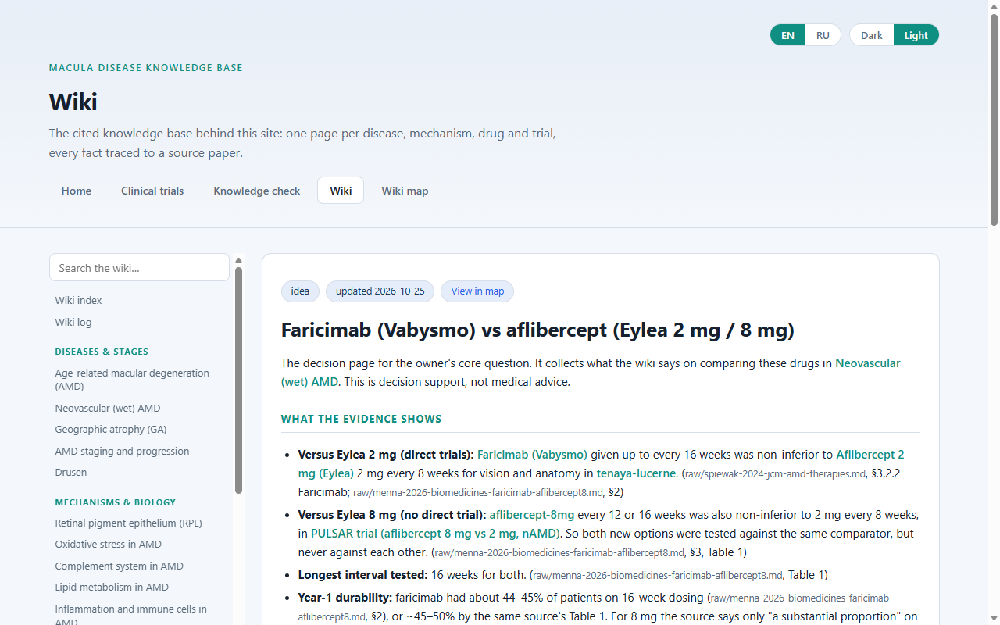
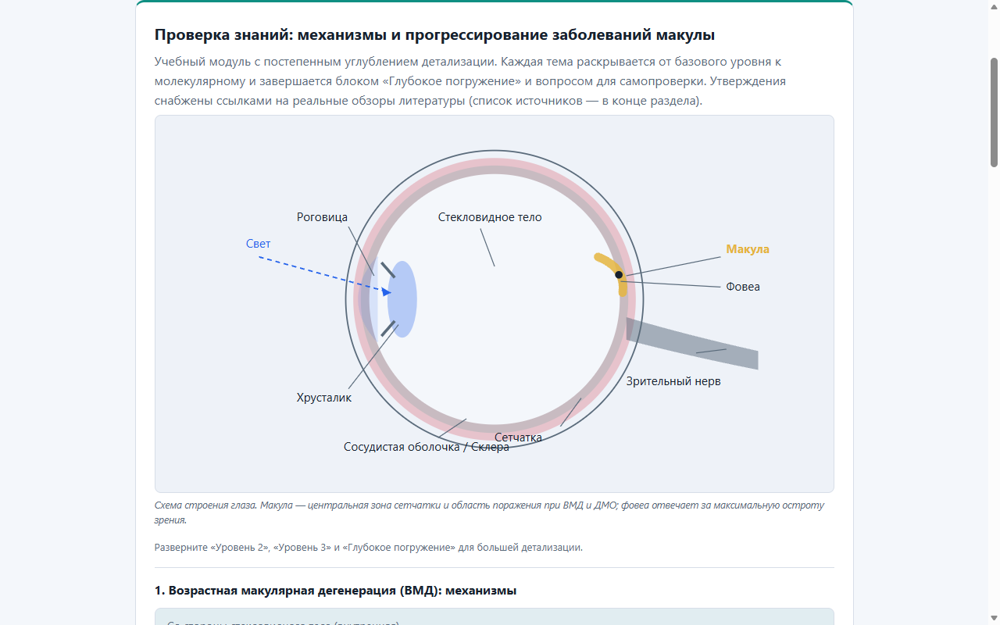
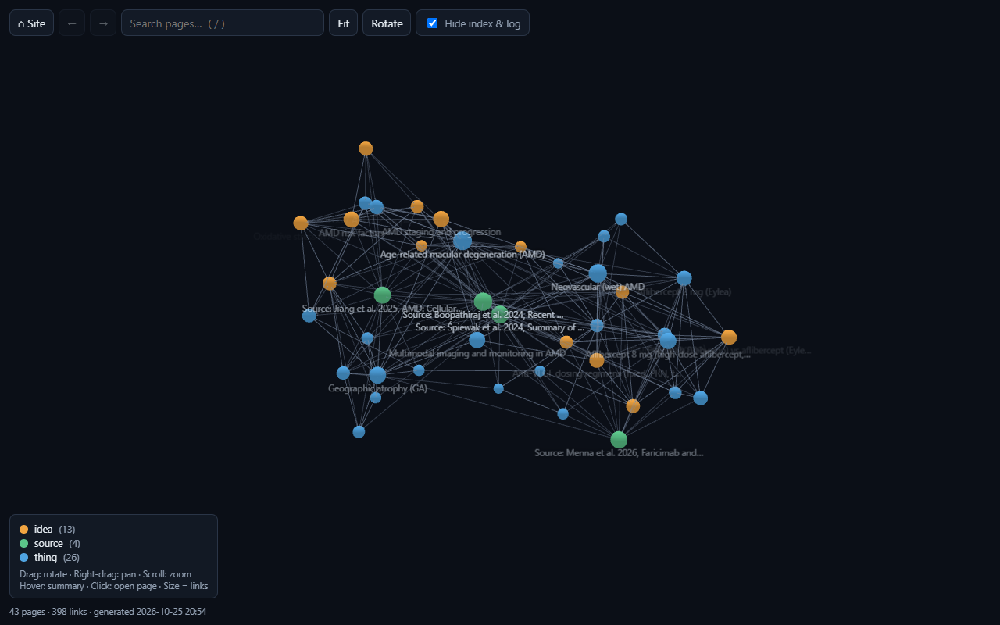

My mother has age-related macular degeneration (AMD). Sooner or later, the conversation with her ophthalmologist will come down to a choice between two injected drugs: **Vabysmo** (faricimab) and **Eylea** (aflibercept). Both are given as injections into the eye, often for years, so the choice matters: it decides how often she has to come in for an injection, and how well the disease stays under control between visits.

I didn't want to walk into that appointment knowing only the brand names. So I built a small website, the [**Macula Disease Knowledge Base**](https://iosinnii.github.io/my-kb-macula-disease/), that collects what the clinical trials and recent reviews actually say, with every fact traced back to its source. It isn't meant to replace her doctor. It's meant to help us ask better questions.

---

### The site

Here it is, live. You can browse it right inside this post, or [open it in a new tab](https://iosinnii.github.io/my-kb-macula-disease/){target="_blank"}.

```{=html}
<div style="border: 1px solid #dee2e6; border-radius: 10px; overflow: hidden; margin: 1rem 0 0.4rem;">
  <iframe src="https://iosinnii.github.io/my-kb-macula-disease/"
          title="Macula Disease Knowledge Base"
          loading="lazy"
          style="display: block; width: 100%; height: 720px; border: 0;"></iframe>
</div>
<p style="font-size: 0.85rem; color: #6c757d; text-align: center;">
  The embedded site opens in its light theme; the toggle in its top-right corner switches to dark or to a Russian interface.
</p>
```

It has four parts:

*   **Clinical trials**: plain-language digests of the pivotal trials comparing faricimab with aflibercept: TENAYA & LUCERNE in wet AMD, and YOSEMITE & RHINE in diabetic macular oedema. Each card covers the design, the treatment arms, the exact posted outcomes and the safety.
*   **Knowledge check**: how AMD works and progresses, explained in layers from basic to molecular. It has hand-drawn diagrams of the eye and of the VEGF / Ang-2 signalling that these drugs target, plus self-check questions, in English and Russian.
*   **Wiki**: the core of the project. There are 43 pages on diseases, mechanisms, drugs and trials, and every statement cites the paper it came from.
*   **Wiki map**: a 3-D graph of how all those pages connect. Click any node to read the page.







---

### How it's built

I built it together with an AI coding assistant (Claude Code), but with strict rules about where knowledge is allowed to come from:

1.  **Sources go into a `raw/` folder and are never edited.** So far these are four recent open-access reviews (2024–2026): a broad clinical update, a review of the molecular mechanisms, a review of therapeutic options, and a perspective comparing faricimab with high-dose aflibercept.
2.  **The wiki is written from those sources only.** Each page covers one idea, drug or trial, and every factual sentence ends with a citation to the source file it came from. When the assistant combines several sources into its own conclusion, that's explicitly labelled as *synthesis*.
3.  **Contradictions are kept, not smoothed over.** When two sources disagree, both claims stay on the page side by side. For example, one review credits omega-3 fatty acids for the 25% benefit of the AREDS2 eye vitamins, while another describes the formula with no omega-3 at all. These disagreements turned out to be some of the most useful findings, because they show exactly which numbers to double-check.
4.  **Open questions go into a research task list**, to be answered later with new sources.

One command regenerates the website's wiki and the 3-D map after every update. The whole site is static files hosted for free on GitHub Pages, and the [source is on GitHub](https://github.com/IOsinnii/my-kb-macula-disease). I've since turned the setup into a reusable template, so I can start the same kind of knowledge base on any other topic in a minute.

---

### What I've learned so far

From the evidence collected so far (summarised on the site's [decision page](https://iosinnii.github.io/my-kb-macula-disease/wiki.html#faricimab-vs-aflibercept){target="_blank"}):

*   **Both newer options keep vision as well as standard Eylea.** In the TENAYA & LUCERNE trials, Vabysmo given up to every 16 weeks was non-inferior to Eylea 2 mg every 8 weeks. In the PULSAR trial, high-dose Eylea 8 mg given every 12 or 16 weeks was too.
*   **The realistic gain is fewer injections, not better vision.** About 45% of patients on Vabysmo were already on 16-week intervals after the first year.
*   **Fewer injections matters in real life.** Outside trials, patients often get fewer injections than they need, and vision suffers. Reviews call this the "durability gap".
*   **There's no head-to-head trial of Vabysmo versus Eylea 8 mg.** Both were tested against the same comparator, but never against each other, so any comparison between them is indirect.
*   **The extra mechanism isn't proven to matter yet.** Vabysmo also blocks angiopoietin-2, which should stabilise blood vessels. But a phase 2 trial found no clear benefit from that part, and its longer intervals may partly come from the dose.
*   **Safety looked similar in the trials.** Neither drug caused more eye inflammation than standard Eylea.

### Questions we'll take to the ophthalmologist

*   How often would each option need to be injected *for her*, and how is the interval adjusted?
*   Which drugs are available and covered here, including Eylea 8 mg?
*   If fluid persists on one drug, is switching to the other an option?
*   What signs at home (e.g. on an Amsler grid) should prompt an earlier visit?

---

### What's next

The site's task list already has the next questions: long-term (3-year) results and any head-to-head comparisons, real-world safety data since approval, and what happens when patients switch drugs. As I add sources, the wiki, the map and the site update together.

*This is a family project to understand the evidence. It isn't medical advice, and every treatment decision belongs with her ophthalmologist.*
