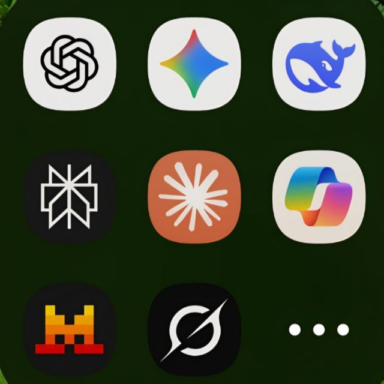

> *“The business plans of the next 10,000 startups are easy to forecast: Take X and add AI. This is a big deal, and now it’s here.”*  
> — **Kevin Kelly**, *Wired* (2014)

I first ran across this quote in the preface to Varma and Das’s [*Deep Learning*](https://srdas.github.io/DLBook/index.html){target="_blank"} book. More than a decade after Kelly wrote it, many of us are still digesting what it actually means in daily practice. 

For a long time, I was an AI skeptic. It took a string of quiet, personal "Aha!" moments—mostly arriving through music, messy data, and late-night curiosity—for me to step through the door with both feet. 

Here is an honest look at that path: why I resisted, what broke through, and why I believe it is still not too late to become a curious autodidact in this space.

---

## 1. Kyiv, 2018: Michelangelo and the Lab Tube

Nobody is born trusting new technology. In 2018, I attended the *Integrative Medicine and Biology* conference in Kyiv. During one of the sessions, a junior researcher around my own career stage took the podium to talk about the promise of big data and machine learning in digital pathology. 

To illustrate the point, the presenter showed a slide featuring Michelangelo’s *The Creation of Adam*—with God’s outstretched hand holding a plastic lab tube. 

My friend next to me chuckled, and I nodded in silent agreement. My internal reaction was dismissive: *“These algorithms only ever output the specific labels in their training sets. How could they possibly compete with the human brain, with its extraordinary plasticity and ability to reason through messy, contradictory biological reality?”*

I didn't recognize the rise of deep learning when it was staring me in the face. In hindsight, I wish I had paid more attention to that talk.

---

## 2. Music as the Gateway: My First Two "Aha!" Moments

My skepticism didn't break down through academic papers or tech keynote speeches. It broke down through my personal hobbies.

### The Bach Counterpoint Experiment (2019)

In 2019, Google released its Bach Doodle—a machine-learning experiment powered by Coconet that generated four-part contrapuntal harmonies in Johann Sebastian Bach’s signature style from any arbitrary melody.

Sitting at my computer, I tapped a handful of simple, monotonic notes on my keyboard and hit generate. Seconds later, the model handed back a multi-voice arrangement with genuine polyphonic depth and voice leading. It sounded surprisingly convincing, and I hadn’t spent hours arranging voice tracks.

  

    🎵 Listen to my 2019 Bach Doodle melody:
  

  

    A small four-part piece generated from a few keystrokes on my laptop.
  

  <a href="bachpiece_Ivan.mid" download class="btn btn-sm btn-outline-primary" style="text-decoration: none;">
    ⬇ Download MIDI file (bachpiece_Ivan.mid)
  </a>

### Transcribing Songs with Chord.ai (~2020)

Outside the lab, singing and playing acoustic guitar are two of my favorite ways to reset. But without formal music theory training, figuring out complex chord voicings and jazzier passing chords by ear took immense time. 

Around 2020, I found a mobile app called [**Chord.ai**](https://chord.ai/){target="_blank"}, which processed audio on the fly and estimated the harmonic progressions of whatever was playing through the microphone. Testing it on intricate acoustic tracks and watching it identify non-obvious chords in seconds was my second real "Aha!" moment. Neural networks weren't just theoretical classifiers in computer vision papers; they were becoming tactile tools that augmented personal hobbies.

---

## 3. From GPT-3.5 Frustration to a Real Personal Assistant

When ChatGPT dropped in late 2022, I was once again late to the party. 

A friend working in advertising had warned me in August 2022: *“You don't know what's coming. By the end of this year, a new service is launching that will completely change how we create copy and interact with language. Let me know if you want early preview access.”* I assumed it was typical Silicon Valley marketing hype and didn't follow up.

When I finally tried GPT-3.5 in mid-2023 for bioinformatics scripting, it felt underwhelming. It hallucinated function arguments in Bioconductor packages, produced brittle boilerplate, and required constant hand-holding.

The real shift arrived in **2024 with GPT-4**. I had just finished my first postdoc position in Basel and had dedicated time between roles. I took two intensive courses: one on practical GPT prompting and workflows, followed by a three-week online program on integrating modern AI tools into scientific research.

The difference was night and day. GPT-4 became a genuine sparring partner:
- It helped me dissect complex edge cases in differential expression pipelines (`edgeR`, `limma`, and `DESeq2`).
- During a technical interview assignment for my next bioinformatics role, using the model to interrogate method documentation and test alternative code structures helped me build a solution that exceeded my expectations.
- It wasn’t replacing my statistical judgment; it was clearing away the friction of lookup and syntax so I could focus on biological interpretation.

Around that time, I also came across talks by **Rachel Thomas** (co-founder of fast.ai), whose core message resonated deeply: **“AI needs all of us.”** 

Thomas argued that despite obvious concerns—training data biases, environmental costs, and hype cycles—AI impacts every domain where computers are used. If domain specialists (scientists, clinicians, educators) refuse to engage because the technology feels imperfect or hyped, we leave its development and governance entirely to others.

---

## 4. Looking Back at 2025: From Chatbots to Autonomous Agents

By late 2025, the nature of AI interaction underwent another fundamental shift. I wrote a short reflection in my personal notes at the end of that year:

::: callout-note
### From My Journal (Late 2025)

*“2025 was a year of rapid transitions. If 2023 and 2024 were about integrating chatbots into existing services, 2025 introduced fundamentally new modalities:*

- *Search grounding: Models began running real-time web queries and integrating live citations into their reasoning context.*
- *Fine-grained vision & voice: Generating and revising graphics step-by-step, alongside natural voice interfaces that freed us from typing on smartphones.*
- *The rise of coding agents: Moving beyond the single-prompt `question → answer` dynamic to agents that execute multi-step internal loops—reading files, diagnosing errors, running bash commands, and iterating autonomously.*

*While remaining cautious about grand claims of bots instantly replacing domain professionals, 2025 genuinely transformed how software and content get built.”*
:::

{fig-alt="Mobile AI apps on smartphone home screen" width="360px" style="display: block; margin: 1.5rem auto; border-radius: 12px; box-shadow: 0 4px 12px rgba(0,0,0,0.1);"}

As Laurence Wu recently framed it:

> *“I used to think coding agents would primarily disrupt software engineering because they write so much code at once. But now I think of them differently: **they write code, and that code performs tasks.** And that is huge.”*

---

## 5. Solo Builders and the "Curious Autodidact"

What excites me most in 2026 is seeing how individual researchers and engineers use these agentic workflows to build meaningful tools single-handedly:

- **Eric Ma** built [*Canvas Chat*](https://ericmjl.github.io/canvas-chat/){target="_blank"}, rethinking conversational interfaces into non-linear, branching canvases.
- **John Damask** developed lightweight browser extensions and the [*Now I get it!*](https://nowigetit.us/){target="_blank"} scientific paper translator, proving how a solo builder can solve genuine information problems in weeks.
- **Hadley Wickham** returned to writing with practical reflections on LLM coding agents, highlighting how voice dictation and agent harnesses make computing far more accessible for people with repetitive strain or physical disabilities.

None of this requires blind techno-optimism. The firehose of daily announcements, marketing exaggeration, and the uneasy feeling of seeing familiar tasks automated in seconds can be disorienting. Keeping your footing requires filtering out the noise and anchoring yourself in permanent fundamentals: good scientific questions, sound experimental design, and empathy for the end user.

John Damask uses a phrase on his site that has become my personal guiding motto: **curious autodidact**.

An autodidact is someone who teaches themselves. In human history, it has never been easier to explore an unfamiliar field, pick up a new language or library, test an idea, or build an application on your own, from anywhere in the world. 

That capability is not a threat—it is an invitation. And as someone working at the intersection of biology and code, I feel a quiet responsibility to make the most of it.
